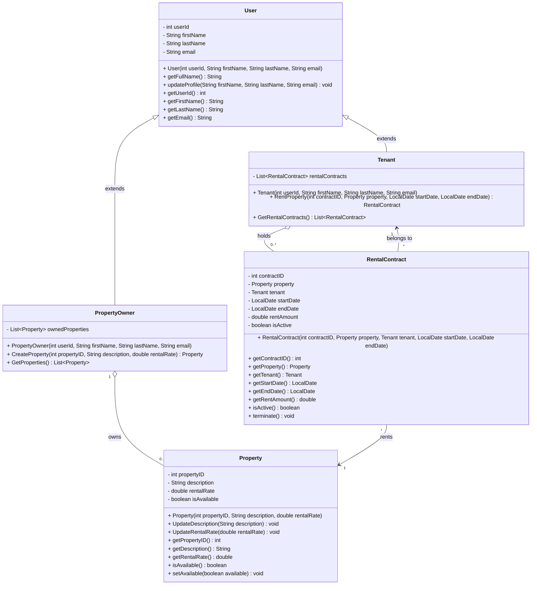

# CSW303.D Rental Management Application

An object-oriented Java project for managing the end-to-end rental process. The target application brings property owners, property managers, and tenants together to manage listings, leases, maintenance, payments, documents, and communication.

> This README describes the complete project scope defined by the course requirements. The current repository is a Java prototype of the core rental domain; the broader application capabilities are part of the target system and are not all implemented yet.

## Project goals

- Give owners and managers a centralized way to organize rental properties and daily operations.
- Help tenants apply for properties, review lease terms, make payments, and request maintenance.
- Keep rental agreements, payment activity, communications, and property records associated with the relevant people and properties.
- Provide useful operational and financial reports while protecting personal and financial information.

## Users and capabilities

### Property owners

- Create and maintain property listings with descriptions, rental rates, and photos.
- Review property availability, leases, rent payments, and property performance.
- Manage rental-related financial activity and documents.

### Property managers

- Organize and promote available properties.
- Manage tenant information, applications, references, and lease agreements.
- Track lease terms, renewal dates, rent payments, and occupancy.
- Assign and track maintenance work.
- Communicate with owners and tenants, and review operational reports.

### Tenants

- Browse available properties and submit rental applications.
- Review lease terms and communicate with owners or managers.
- Submit maintenance requests and follow their status.
- Access relevant lease and rental documents and payment information.

## Functional requirements

1. **Property listings** - Create detailed listings containing descriptions, rental rates, and property photos. Organize and promote properties that are available for rent.
2. **Tenant management** - Maintain tenant information, applications, references, and lease agreements. Allow tenants to apply, review lease terms, and communicate with property managers.
3. **Lease tracking** - Track lease agreements, rental periods, renewal dates, and rent payments.
4. **Maintenance requests** - Let tenants submit requests and track their status. Let managers assign and manage maintenance tasks.
5. **Financial management** - Record rental-related financial transactions, including rent collection.
6. **Communication and messaging** - Support messages and notifications between property owners, managers, and tenants.
7. **Document management** - Store and manage lease agreements, rental applications, property inspection reports, and other essential rental documents.
8. **Reporting and analytics** - Provide insights into property performance, financial activity, occupancy rates, and maintenance history.
9. **Security and data protection** - Protect sensitive personal and financial information through appropriate security measures.

## Core object-oriented model

The Week 2 technical specification defines these core classes and behaviors:

| Class | Responsibilities |
|---|---|
| `User` | Store the user ID, first name, last name, and email. Provide a constructor, `getFullName()`, and `updateProfile(firstName, lastName, email)`. |
| `PropertyOwner` | Extend `User` and initialize an empty list of owned properties. `CreateProperty(propertyID, description, rentalRate)` creates and registers a `Property`; `GetProperties()` returns the owned property objects. |
| `Tenant` | Extend `User` and initialize an empty list of rental contracts. `RentProperty(contractID, property, startDate, endDate)` creates and registers a contract; if creation fails, the contract list remains unchanged. `GetRentalContracts()` returns all contracts, including terminated contracts. |
| `Property` | Store a unique property ID, description, monthly rental rate, and availability (initially `true`). Reject a rental rate less than or equal to zero. `UpdateDescription(description)` replaces the description; `UpdateRentalRate(rentalRate)` changes the rate only when it is valid. |
| `RentalContract` | Store a unique contract ID, property, tenant, start date, end date, agreed monthly rent, and active status (initially `true`). A contract can be created only for an available property and a valid rental period. `Terminate()` deactivates an active contract and makes the property available; terminating an inactive contract has no effect. |

### Domain relationships

- A `PropertyOwner` owns zero or more `Property` objects.
- A `Tenant` holds zero or more `RentalContract` objects.
- Every `RentalContract` references one `Property` and one `Tenant`.
- `PropertyOwner` and `Tenant` inherit from `User`.
- For the simplified rental model, a property's availability depends on whether it has an active contract, not on the current date.



## Main rental workflow

1. An owner creates a property listing with a description and valid monthly rental rate.
2. A tenant selects an available property and submits a rental period.
3. The application validates the property and dates, creates a contract with the agreed rent, and marks the property unavailable.
4. Owners and managers track the lease and related payments, documents, messages, and maintenance activity.
5. When the contract is terminated, it becomes inactive and the property becomes available again. The contract remains in the tenant's contract history.

## Technology and project structure

- **Language:** Java (JDK 8 or later)
- **Core concepts:** classes, inheritance, object relationships, collections, and `LocalDate`
- **Current entry point:** `Application`

```text
src/
  Application.java
  Property.java
  PropertyOwner.java
  RentalContract.java
  Tenant.java
  User.java
docs/
  requirements/
    Group Project week 1.pdf
    Group Project week 2.pdf
    Group Project week 3.pdf
```

## Run the current prototype

From the repository root in PowerShell, compile the Java sources and run the sample rental workflow:

```powershell
New-Item -ItemType Directory -Force out | Out-Null
javac -d out src\*.java
java -cp out Application
```

The current demo creates an owner, a tenant, a property, and a rental contract; displays their state; updates the property's rate; and terminates the contract. The complete capabilities described above define the target system and require further implementation beyond this demo.

## Course requirements

The original project description and weekly specifications are included in [`docs/requirements`](docs/requirements/).

## Team

| Role | Student | GitHub | Assigned classes/tasks |
|---|---|---|---|
| Team Lead | Nguyễn Trọng Tiến | [@nguyentrongtien-vn](https://github.com/nguyentrongtien-vn) | Project setup, Git workflow, architecture, README, `RentalContract` |
| Member | Bùi Nguyễn Anh | [@anhbuinguyencit23](https://github.com/anhbuinguyencit23) | `PropertyOwner` |
| Member | Nguyễn Đỗ Huy Hoàng | [@NguyenDoHuyHoang](https://github.com/NguyenDoHuyHoang) | `User`, `Tenant` |
| Member | Nguyễn Trường Thịnh | [@thinhnguyentruongcit23-svg](https://github.com/thinhnguyentruongcit23-svg) | `Property`, application, testing |

## Project links

- [Trello board](https://trello.com/b/gIMEFvVa/csw303d-rental-management-app)
- [GitHub repository](https://github.com/nguyentrongtien-vn/csw303.d-rental-management-app)
