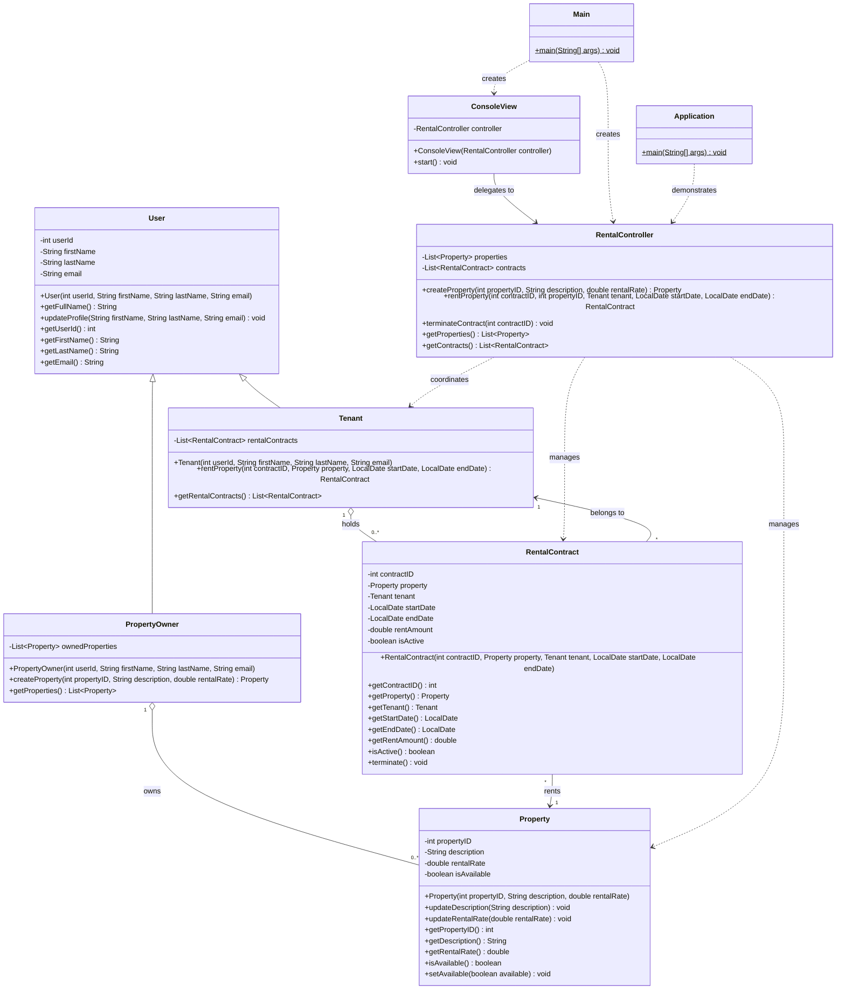

# CSW303.D Rental Management Application

An object-oriented Java application for managing the end-to-end rental process. The target system brings property owners, property managers, and tenants together to manage listings, leases, maintenance, payments, documents, and communication.

> This README describes both the broader target system scope defined by the course requirements and the current Java MVC implementation covering the core rental domain, input validation, console UI, and automated JUnit 5 test suite.

## Project goals

- Give owners and managers a centralized way to organize rental properties and daily operations.
- Help tenants apply for properties, review lease terms, make payments, and request maintenance.
- Keep rental agreements, payment activity, communications, and property records associated with the relevant people and properties.
- Provide useful operational and financial reports while protecting personal and financial information.

## Users and capabilities

### Property owners

- Create and maintain property listings with descriptions, rental rates, and photos.
- Review property availability, leases, rent payments, and property performance.
- Manage rental-related financial activity and documents.

### Property managers

- Organize and promote available properties.
- Manage tenant information, applications, references, and lease agreements.
- Track lease terms, renewal dates, rent payments, and occupancy.
- Assign and track maintenance work.
- Communicate with owners and tenants, and review operational reports.

### Tenants

- Browse available properties and submit rental applications.
- Review lease terms and communicate with owners or managers.
- Submit maintenance requests and follow their status.
- Access relevant lease and rental documents and payment information.

## Functional requirements

1. **Property listings** - Create detailed listings containing descriptions, rental rates, and property photos. Organize and promote properties that are available for rent.
2. **Tenant management** - Maintain tenant information, applications, references, and lease agreements. Allow tenants to apply, review lease terms, and communicate with property managers.
3. **Lease tracking** - Track lease agreements, rental periods, renewal dates, and rent payments.
4. **Maintenance requests** - Let tenants submit requests and track their status. Let managers assign and manage maintenance tasks.
5. **Financial management** - Record rental-related financial transactions, including rent collection.
6. **Communication and messaging** - Support messages and notifications between property owners, managers, and tenants.
7. **Document management** - Store and manage lease agreements, rental applications, property inspection reports, and other essential rental documents.
8. **Reporting and analytics** - Provide insights into property performance, financial activity, occupancy rates, and maintenance history.
9. **Security and data protection** - Protect sensitive personal and financial information through appropriate security measures.

## Core architecture & object-oriented model

The application follows the **Model–View–Controller (MVC)** architectural pattern (Week 4) built on top of the validated core domain model (Weeks 2 & 3):

### MVC layers

| Layer | Package / Class | Responsibilities |
|---|---|---|
| **Model** | `model.*` (`User`, `PropertyOwner`, `Tenant`, `Property`, `RentalContract`) | Encapsulate domain entities, business rules, state invariants, and input validation. Completely decoupled from console I/O (`Scanner` / `System.out`). |
| **View** | `view.ConsoleView` | Provide the interactive CLI menu (`1. Create property`, `2. Rent`, `3. Terminate`, `4. Exit`), parse user input safely, and display friendly feedback without crashing on invalid operations. |
| **Controller** | `controller.RentalController` | Coordinate user actions (`createProperty`, `rentProperty`, `terminateContract`), manage in-memory storage, prevent duplicate IDs, and delegate domain rules to the Model. |
| **Entry Points** | `Main`, `Application` | `Main` launches the interactive MVC console application; `Application` runs an automated end-to-end demonstration of valid and invalid rental workflows. |

### Core domain classes

| Class | Responsibilities |
|---|---|
| `User` | Store positive `userId`, validated `firstName`, `lastName`, and regex-validated `email`. Provide `getFullName()` and atomic `updateProfile(firstName, lastName, email)`. |
| `PropertyOwner` | Extend `User` and maintain owned properties. `createProperty(propertyID, description, rentalRate)` delegates validation to `Property` and registers valid instances; `getProperties()` returns an unmodifiable list. |
| `Tenant` | Extend `User` and maintain rental contracts. `rentProperty(contractID, property, startDate, endDate)` delegates validation to `RentalContract` and preserves contract history if creation fails; `getRentalContracts()` returns all contracts, including terminated ones. |
| `Property` | Store a positive `propertyID`, non-blank `description`, finite positive `rentalRate`, and availability (`true` by default). `updateDescription(...)` and `updateRentalRate(...)` preserve existing values on invalid input. |
| `RentalContract` | Store a positive `contractID`, `property`, `tenant`, `startDate`, `endDate` (strictly after `startDate`), agreed `rentAmount`, and `isActive` (`true` by default). `terminate()` deactivates an active contract and frees the property; terminating an inactive contract is a safe no-op. |

### Domain & MVC relationships

- A `PropertyOwner` owns zero or more `Property` objects.
- A `Tenant` holds zero or more `RentalContract` objects.
- Every `RentalContract` references one `Property` and one `Tenant`.
- `PropertyOwner` and `Tenant` inherit from `User`.
- `ConsoleView` interacts strictly with `RentalController`, which orchestrates `model` entities.

